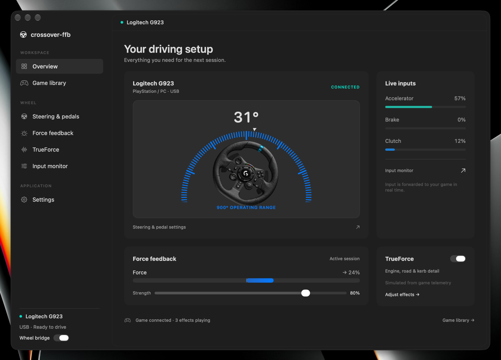
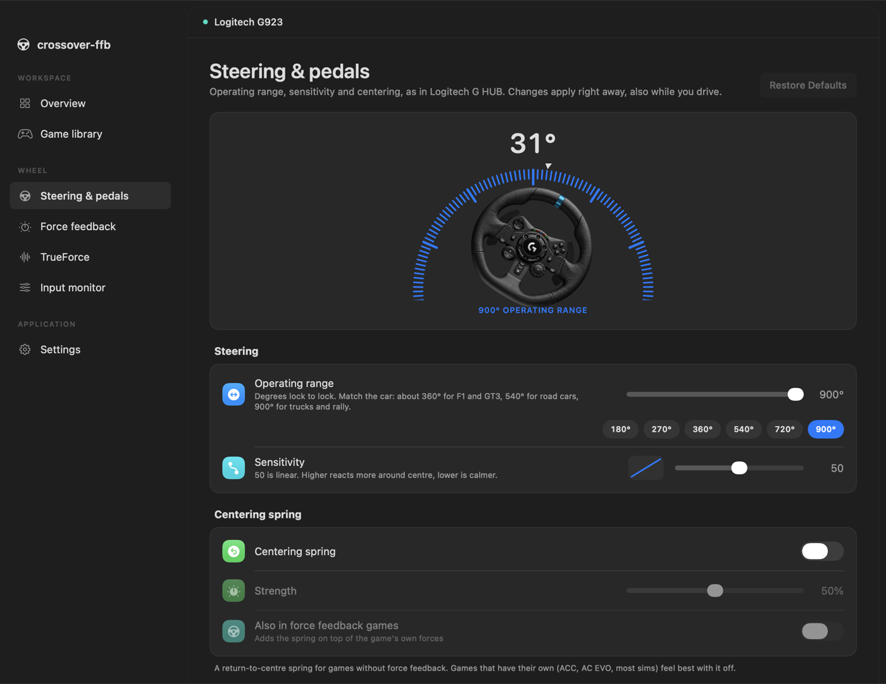
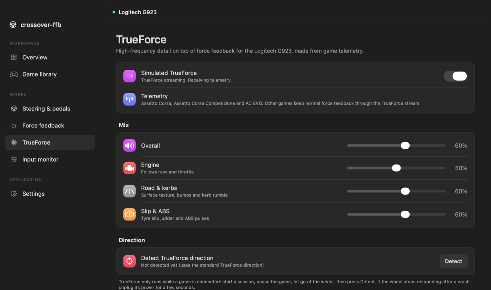
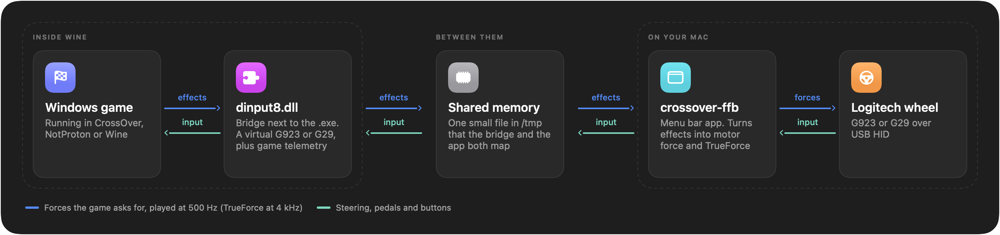

<p align="center">
  
</p>

<h1 align="center">crossover-ffb</h1>

<p align="center">
  <b>Force feedback and TrueForce for Logitech wheels in Windows racing games on macOS.</b><br>
  For games running through CrossOver, NotProton or Wine.
</p>

---

Windows sims run well on Apple Silicon through Wine, but the wheel arrives dead: no force
feedback, sometimes no wheel at all. crossover-ffb fixes that. It's a small menu bar app plus
a Windows DLL that it installs into your games for you. The game sees a normal Logitech G923
or G29, and its forces reach the real wheel on your Mac.

- **Force feedback.** Constant forces, springs, dampers, friction, periodic effects and
  envelopes, played on the motor at about 500 Hz.
- **Simulated TrueForce.** Engine, road texture, kerbs, tyre slip and ABS, generated from the
  game's telemetry and streamed to the G923's TrueForce motor channel at 4 kHz.
- **One-click install.** The app finds your games on any disk (internal, SSD, external) in
  Steam + NotProton, CrossOver bottles, or any Wine prefix. **Uninstall** restores exactly what
  was there before.
- **G HUB-style wheel settings.** Operating range from 40° to 900°, steering and pedal
  sensitivity curves, a centering spring, combined pedals, and rev lights driven by the game's rpm.
- **Lives in the menu bar.** A Liquid Glass menu shows steering, pedals and force at a glance.
  The dashboard window has the game library, wheel, force-feedback and TrueForce settings, and a
  live input monitor.

## What's new in 0.3.0

- **Experimental G29 identity.** The new bridge, still a work in progress, presents a connected
  G29 to games as a G29 instead of a G923, so G29 presets and bindings can match. It hasn't been
  tested on a G29 yet. Reports are welcome in [#1](../../issues/1). See
  [Bridge foundations](#bridge-foundations-in-030).
- **New interface.** The menu is a single Liquid Glass surface with native sliders and
  switches. The dashboard has a slimmer header, clearer empty states, and page titles that
  match the sidebar.
- **Honest about other wheels.** A G923 for Xbox, RS50 or G PRO is recognised and shown as
  not supported yet. The app never attaches to it or writes to it.
- **Better diagnostics.** The bridge log records which wheel each game was offered.
- **Groundwork for Logitech's native SDK and newer wheels.** It's present in the code but
  disabled and not hardware-tested.

Update the bridge in each game after upgrading: the Library shows **Update**. The app and the
bridge must both be 0.3.0 for the G29 identity.

## Compatibility

| | Status |
|---|---|
| **Wheels** | Logitech **G923** (PlayStation/PC, `046d:c266`): tested. Logitech **G29** (`046d:c24f`): supported but untested on hardware; its own identity in games is experimental. TrueForce is G923 only. |
| **Not supported yet** | G923 for Xbox (`c26e`, `c26d`), RS50 (`c276`), G PRO (`c268`), and `c272`, which RS50 and G PRO share. Shown in the app, never driven. |
| **macOS** | 13 Ventura or later on Apple Silicon. Liquid Glass on macOS 26 and later. |
| **Runners** | Steam games through **NotProton**, **CrossOver** bottles (including Steam inside a bottle), any other Wine prefix via **Add Game** |
| **Games** | Any **64-bit** game that reads its wheel through **DirectInput 8**, which covers most PC sims |

| Game | Force feedback | TrueForce |
|---|---|---|
| Assetto Corsa Competizione | ✅ tested | ✅ full (telemetry) |
| Assetto Corsa EVO | ✅ tested | ✅ full (telemetry) |
| Assetto Corsa | being investigated with a G29 ([#1](../../issues/1)) | full (telemetry) |
| Automobilista 2, rFactor 2, Le Mans Ultimate, RaceRoom, BeamNG.drive | should work | FFB only, no extra detail |

"Should work" means the game uses DirectInput 8 but nobody has reported on it yet. If you try
one, please [file a game report](../../issues/new?template=game-report.md). Games that only
use XInput or raw HID, and 32-bit games, aren't supported.

## Install

1. Download `crossover-ffb-<version>.dmg` from [Releases](../../releases/latest), open it
   and drag **crossover-ffb** to Applications.
2. The app is not notarized. The first time, right-click it and choose **Open** (or allow it
   in System Settings › Privacy & Security).
3. A steering wheel icon appears in the menu bar. If the app asks for **Input Monitoring**,
   allow crossover-ffb in System Settings › Privacy & Security › Input Monitoring. It needs
   this to read your wheel.

To remove it, uninstall the bridge from each game in the Library, then delete the app.

## Set up a game

1. Open the dashboard from the menu and go to **Game library**. Your games appear by
   themselves. If one is missing, press **Add Game** and pick its `.exe`. For a Steam +
   NotProton game, launch it once first so its Wine prefix exists.
2. Quit the game and press **Install**.
3. Once, with no game running and your hands off the wheel: **Force feedback › Detect**. This
   learns which way your motor turns.
4. Start the game, pick your wheel in its controls and calibrate. It's listed as
   **"G923 Racing Wheel for PlayStation and PC"** or **"G29 Driving Force Racing Wheel"**. The
   menu shows the game as connected and the force meter moves.
5. If the wheel pushes *away* from centre in corners, turn on **Reverse game force direction**.

For ACC, the default G923 preset already matches the layout: steering axis 0, throttle 1,
brake 5, clutch 6. Coming from 0.2.x with a G29, select the wheel again in each game, because
older versions presented it as a G923.

### Steering & pedals



**Steering & pedals** has the options Logitech G HUB offers for the G923 and G29, which G HUB
can't provide under Wine:

- **Operating range**, 40° to 900°, with presets for 180°, 270°, 360°, 540°, 720° and 900°.
  The wheel reports full steering over that angle and holds a soft stop at the ends.
- **Sensitivity**, a response curve where 50 is linear. The same curve is available for each pedal.
- **Centering spring**, for games without force feedback, optionally on top of the game's own forces.
- **Torque** and, on the G923, **audio effects**, which are the force-feedback and TrueForce strengths.
- **Combined pedals**, which put the accelerator and brake on one axis for older games.
- **Rev lights**. The LEDs fill up with the engine's rpm and flash at the limiter
  (Assetto Corsa, ACC and AC EVO).

<br clear="right">

### TrueForce



Real TrueForce needs Logitech G HUB and Logitech's SDK inside the game, and neither runs under
stock Wine. crossover-ffb simulates it instead. The bridge copies the game's physics telemetry
into shared memory, and the app turns it into a haptic signal: engine firing pulses that follow
rpm and throttle, suspension and road texture, kerb rumble, tyre-slip judder and ABS pulses.

- Turn it on in the menu, and set the mix on the **TrueForce** page. The page only appears
  while a G923 with its TrueForce interface is connected.
- In game, pause, let go of the wheel and press **Detect** once to learn the stream's direction.
- Games without telemetry still get normal force feedback through the TrueForce stream.
- If the wheel stops responding after a crash, unplug its power for a few seconds.

<br clear="right">

## How it works

<p align="center">
  
</p>

- The installer copies `dinput8.dll` next to the game's .exe and adds a per-game
  `dinput8 = native,builtin` override to the Wine prefix. Any DLL or override that was already
  there is backed up and put back on uninstall.
- The DLL presents one virtual wheel with the connected model's Logitech name and IDs, so
  in-game presets apply. It uses the standard layout: X steering, Y throttle, Rz brake, Slider
  clutch, 25 buttons and a D-pad. The physical G923 or G29 is hidden so the game sees one wheel.
  Keyboards, mice and other controllers pass through to Wine's own dinput8.
- Effects the game creates are mirrored to the app over shared memory
  (`/tmp/crossover-ffb-<uid>/ffb-v2.bin`, see [bridge/SHARED-MEMORY.md](bridge/SHARED-MEMORY.md)).
  The app computes them against live wheel motion and drives the motor.
- The DLL is written freestanding: it imports only KERNEL32, and it writes a log,
  `crossover-ffb-observe.log`, next to the game's .exe.

## Bridge foundations in 0.3.0

0.3.0 starts a new bridge that's still in progress. It changes what the bridge tells games,
and adds groundwork that stays switched off until it's proven on real hardware.

**Wheel identity (experimental, untested on a G29).** The app publishes the connected wheel's USB ID (`046d:c24f` G29,
`046d:c266` G923) alongside the input, in a previously unused slot of the shared memory. The
file layout and protocol version don't change. The DLL uses that one value for everything a
game can ask: enumeration, `GetDeviceInfo`, the product and instance names, and
`DIPROP_VIDPID`. A G29 is named "G29 Driving Force Racing Wheel" with product GUID
`{c24f046d-0000-0000-0000-504944564944}`. The G923 keeps its name and GUID. The virtual
instance GUID is unchanged, so instance-keyed bindings survive. If either side is older, the
DLL falls back to the G923 identity. Start the app before the game, because some games cache
the wheel's identity.

**Diagnostics.** Games choose their wheel from DirectInput enumeration alone. The log
(tagged `cfb-bridge-v3`) now records each enumeration: the device kind requested, whether the
virtual wheel was offered and with which product GUID, how many physical wheels were hidden,
and the result. A report's log now shows which wheel the game was offered, not only what it
read.

**Native SDK groundwork (disabled).** Real TrueForce comes from Logitech's own SDK DLL, the
one G HUB ships, which needs a patched Wine to reach the wheel. The pieces on our side exist
but are inactive:

- When the SDK asks the virtual wheel for its device path, the bridge can return the real PS
  G923's path. It refuses when there's no wheel or more than one, and never invents a path.
- `--sdk-input-only` runs the app as a reader only. It never writes to the motor, so it can't
  fight the SDK.
- Checks for the SDK DLL and a launch plan writer exist. Nothing installs the SDK, patches
  Wine, changes a bottle or launches a game.

**Newer wheels (disabled).** Read-only profiles identify the G923 for Xbox, RS50 and G PRO, and
treat `c272` as ambiguous because both RS50 and G PRO use it. Offline encoders cover the Xbox
G923's HID++ force effects and the RS50/G PRO direct-drive stream. They're tested against
synthetic data only. No output is sent to these wheels, and no torque scaling is assumed.

The acceptance gates for turning any of this on are in
[docs/NATIVE-WHEEL-FOUNDATION.md](docs/NATIVE-WHEEL-FOUNDATION.md).

## Safety

The motor is driven only while a game is connected and polling, with a heartbeat of 500 ms or
less. Paused or stalled games, Stop commands, quitting the app and unplugging all zero the
force. If the app is force-killed while a game holds a force, the wheel can keep that force
until you unplug it. Strength defaults to 80%. Keep your hands clear when running **Detect**.
Unsupported wheels are never written to.

## Building from source

```sh
brew install llvm lld   # cross-compiles the Windows DLL
./scripts/package-app   # tests and builds the DLL, then dist/crossover-ffb.app and a .dmg
```

Requires Xcode 26 (Swift 6). The scripts build with SwiftPM's native build system, because
the default one records an old SDK version in the binary and macOS then draws legacy controls.
See [CONTRIBUTING.md](CONTRIBUTING.md) for tests, the diagnostic CLI (`crossover-ffb games`,
`bridge-probe`, `trueforce-probe`) and the code layout. `CrossoverFFBApp --simulate-wheel g29`
(or `g923`, `rs50`, `disconnected` and others) shows the interface with a sample wheel and
hardware disabled.

## Contributing

Reports from other games and wheels are the most useful help right now, especially from G29
owners. See [CONTRIBUTING.md](CONTRIBUTING.md).

## Credits

- TrueForce and direct-drive protocol facts come from the public notes of
  [mescon/logitech-trueforce-linux-driver](https://github.com/mescon/logitech-trueforce-linux-driver).
- Classic Logitech force-feedback commands were cross-checked against
  [berarma/new-lg4ff](https://github.com/berarma/new-lg4ff).
- The native SDK groundwork follows the approach reported by
  [armax9/g923-control-center](https://github.com/armax9/g923-control-center).

All code here is original. No driver or SDK code was copied.

## License

[MIT](LICENSE).

crossover-ffb is not affiliated with Logitech, Kunos Simulazioni, CodeWeavers or Valve. Logitech,
G923, G29, G PRO, RS50 and TrueForce are trademarks of Logitech. Game names and artwork belong to
their owners.
