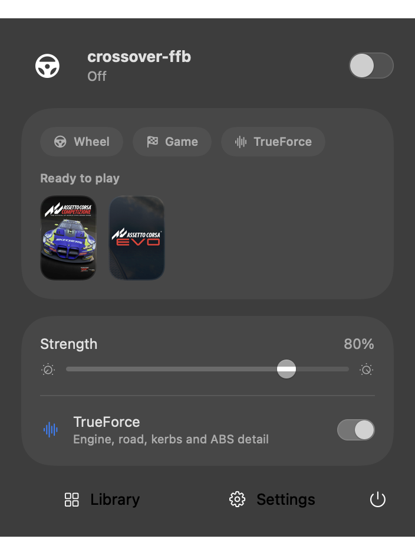
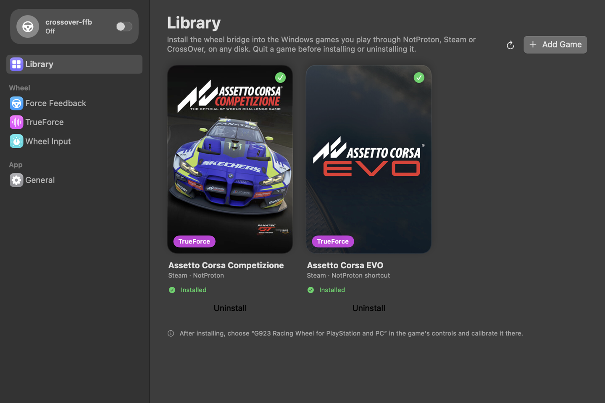
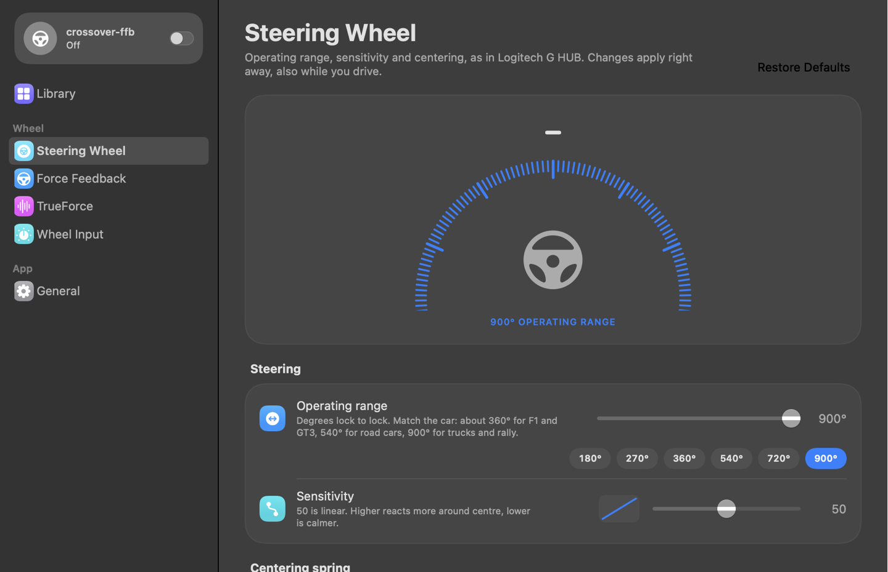
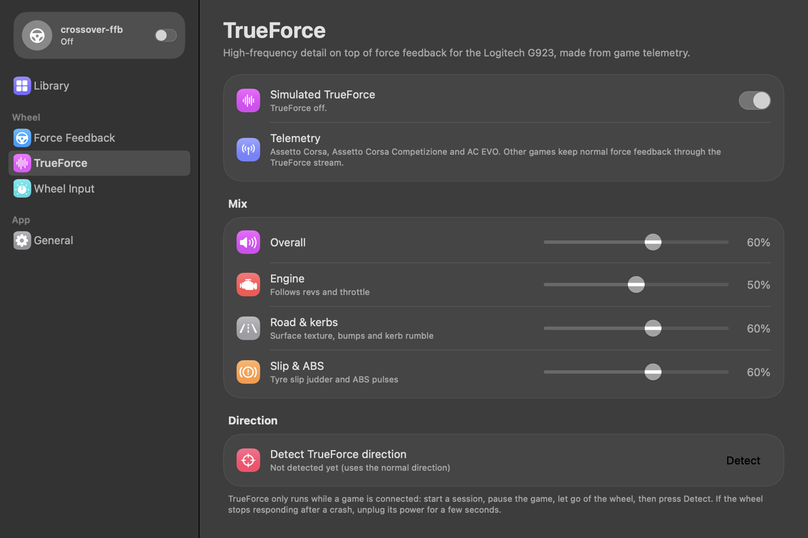

<p align="center">
  
</p>

<h1 align="center">crossover-ffb</h1>

<p align="center">
  <b>Force feedback and TrueForce for Logitech wheels in Windows racing games on macOS.</b><br>
  For games running through CrossOver, NotProton or Wine.
</p>

---

Windows sims run well on Apple Silicon through Wine, but the wheel arrives dead: no force
feedback, sometimes no wheel at all. crossover-ffb fixes that. It's a small menu bar app plus
a Windows DLL that it installs into your games for you. The game sees a normal Logitech G923,
and its forces reach the real wheel on your Mac.

- **Force feedback.** Constant forces, springs, dampers, friction, periodic effects and
  envelopes, played on the motor at about 500 Hz.
- **Simulated TrueForce.** Engine, road texture, kerbs, tyre slip and ABS, generated from the
  game's telemetry and streamed to the G923's TrueForce motor channel at 4 kHz.
- **One-click install.** The app finds your games on any disk (internal, SSD, external) in
  Steam + NotProton, CrossOver bottles, or any Wine prefix. **Uninstall** restores exactly what
  was there before.
- **G HUB-style wheel settings.** Operating range from 40° to 900°, steering and pedal
  sensitivity curves, a centering spring, combined pedals, and rev lights driven by the game's rpm.
- **Lives in the menu bar.** No Dock icon. A full Settings window has the game library,
  force-feedback and TrueForce tuning, and a live input view.

<p align="center">
  
</p>

## Compatibility

| | Status |
|---|---|
| **Wheels** | Logitech **G923** (PlayStation/PC, `046d:c266`): tested. Logitech **G29** (`046d:c24f`): force feedback should work but is untested. TrueForce is G923 only. |
| **macOS** | 13 Ventura or later on Apple Silicon. Liquid Glass styling on macOS 26. |
| **Runners** | Steam games through **NotProton**, **CrossOver** bottles (including Steam inside a bottle), any other Wine prefix via **Add Game** |
| **Games** | Any **64-bit** game that reads its wheel through **DirectInput 8**, which covers most PC sims |

| Game | Force feedback | TrueForce |
|---|---|---|
| Assetto Corsa Competizione | ✅ tested | ✅ full (telemetry) |
| Assetto Corsa EVO | ✅ tested | ✅ full (telemetry) |
| Assetto Corsa | should work | full (telemetry) |
| Automobilista 2, rFactor 2, Le Mans Ultimate, RaceRoom, BeamNG.drive | should work | FFB only, no extra detail |

"Should work" means the game uses DirectInput 8 but nobody has reported on it yet. If you try
one, please [file a game report](../../issues/new?template=game-report.md). Games that only
use XInput or raw HID, and 32-bit games, aren't supported.

## Install

1. Download `crossover-ffb-<version>.dmg` from [Releases](../../releases/latest), open it
   and drag **crossover-ffb** to Applications.
2. The app is not notarized. The first time, right-click it and choose **Open** (or allow it
   in System Settings › Privacy & Security).
3. A steering wheel icon appears in the menu bar. If the app asks for **Input Monitoring**,
   allow crossover-ffb in System Settings › Privacy & Security › Input Monitoring. It needs
   this to read your wheel.

To remove it, uninstall the bridge from each game in the Library, then delete the app.

## Set up a game

1. Open **Settings › Library**. Your games appear by themselves. If one is missing, press
   **Add Game** and pick its `.exe`. For a Steam + NotProton game, launch it once first so its
   Wine prefix exists.
2. Quit the game and press **Install**.
3. Once, with no game running and your hands off the wheel: **Settings › Force Feedback ›
   Detect**. This learns which way your motor turns.
4. Start the game, pick **"G923 Racing Wheel for PlayStation and PC"** in its controls, and
   calibrate. The menu shows the game as connected and the force meter moves.
5. If the wheel pushes *away* from centre in corners, turn on **Reverse game force direction**.

For ACC, the default G923 preset already matches the layout: steering axis 0, throttle 1,
brake 5, clutch 6.

### Steering wheel settings



**Settings › Steering Wheel** has the options Logitech G HUB offers for the G923 and G29,
which G HUB can't provide under Wine:

- **Operating range**, 40° to 900°, with presets for 180°, 270°, 360°, 540°, 720° and 900°.
  The wheel reports full steering over that angle and holds a soft stop at the ends.
- **Sensitivity**, a response curve where 50 is linear. The same curve is available for each pedal.
- **Centering spring**, for games without force feedback, optionally on top of the game's own forces.
- **Torque** and **audio effects**, which are the force-feedback and TrueForce strengths.
- **Combined pedals**, which put the accelerator and brake on one axis for older games.
- **Rev lights**. The LEDs fill up with the engine's rpm and flash at the limiter
  (Assetto Corsa, ACC and AC EVO).

<br clear="right">

### TrueForce



Real TrueForce needs Logitech G HUB and Logitech's SDK inside the game, and neither runs under
Wine. crossover-ffb simulates it instead. The bridge copies the game's physics telemetry into
shared memory, and the app turns it into a haptic signal: engine firing pulses that follow rpm
and throttle, suspension and road texture, kerb rumble, tyre-slip judder and ABS pulses.

- Turn it on in the menu, and set the mix in **Settings › TrueForce**.
- In game, pause, let go of the wheel and press **Detect** once to learn the stream's direction.
- Games without telemetry still get normal force feedback through the TrueForce stream.
- If the wheel stops responding after a crash, unplug its power for a few seconds.

<br clear="right">

## How it works

```
 game (Wine) ──DirectInput 8──► dinput8.dll ──shared memory──► crossover-ffb.app ──USB HID──► wheel
             ◄── virtual G923 ◄──────── input ◄─────────────────── input ◄──────────────
```

- The installer copies `dinput8.dll` next to the game's .exe and adds a per-game
  `dinput8 = native,builtin` override to the Wine prefix. Any DLL or override that was already
  there is backed up and put back on uninstall.
- The DLL presents a virtual **"G923 Racing Wheel for PlayStation and PC"** with Logitech's
  name and IDs, so in-game presets apply. It uses the standard layout: X steering, Y
  throttle, Rz brake, Slider clutch, 25 buttons and a D-pad. Keyboards, mice and other
  controllers pass through to Wine's own dinput8.
- Effects the game creates are mirrored to the app over shared memory
  (`/tmp/crossover-ffb-<uid>/ffb-v2.bin`, see [bridge/SHARED-MEMORY.md](bridge/SHARED-MEMORY.md)).
  The app computes them against live wheel motion and drives the motor.
- The DLL is written freestanding: it imports only KERNEL32, and it writes a log,
  `crossover-ffb-observe.log`, next to the game's .exe.

## Safety

The motor is driven only while a game is connected and polling, with a heartbeat of 500 ms or
less. Paused or stalled games, Stop commands, quitting the app and unplugging all zero the
force. If the app is force-killed while a game holds a force, the wheel can keep that force
until you unplug it. Strength defaults to 80%. Keep your hands clear when running **Detect**.

## Building from source

```sh
brew install llvm lld   # cross-compiles the Windows DLL
./scripts/package-app   # tests and builds the DLL, then dist/crossover-ffb.app and a .dmg
```

Requires Xcode 26 (Swift 6). See [CONTRIBUTING.md](CONTRIBUTING.md) for tests, the
diagnostic CLI (`crossover-ffb games`, `bridge-probe`, `trueforce-probe`) and the code layout.

## Contributing

Reports from other games and wheels are the most useful help right now. See
[CONTRIBUTING.md](CONTRIBUTING.md).

## Credits

- TrueForce protocol facts come from the public notes of
  [mescon/logitech-trueforce-linux-driver](https://github.com/mescon/logitech-trueforce-linux-driver).
- Classic Logitech force-feedback commands were cross-checked against
  [berarma/new-lg4ff](https://github.com/berarma/new-lg4ff).

All code here is original. No driver or SDK code was copied.

## License

[MIT](LICENSE).

crossover-ffb is not affiliated with Logitech, Kunos Simulazioni, CodeWeavers or Valve. Logitech,
G923, G29 and TrueForce are trademarks of Logitech. Game names and artwork belong to their owners.
